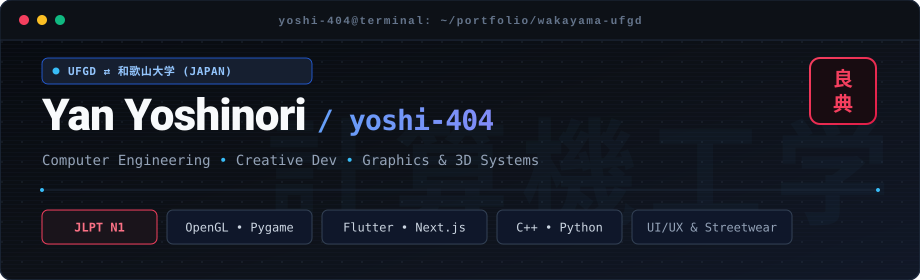

<!-- ============================================================ -->
<!-- HEADER BANNER: SVGによるライト / ダークテーマ対応            -->
<!-- ============================================================ -->

  <picture>
    <source media="(prefers-color-scheme: dark)" srcset="./assets/header-dark.svg">
    <source media="(prefers-color-scheme: light)" srcset="./assets/header-light.svg">
    
  </picture>

  <a href="./README.md">English</a> &nbsp;|&nbsp;
  <a href="./README.pt-BR.md">Português</a> &nbsp;|&nbsp;
  <b>日本語</b>

# Yan Yoshinori (良典)
### 計算機工学 • クリエイティブデベロッパー • 3Dグラフィックス & システム

`UFGD（ブラジル）⇄ 和歌山大学` &nbsp;•&nbsp; `JLPT N1 取得` &nbsp;•&nbsp; `TOEIC 840点`

  <b>コンピュータグラフィックス</b>、<b>ソフトウェア工学</b>、<b>インタラクティブなインターフェース</b>の交差点で活動しています。 
  低レイヤー開発（C++、OpenGL、シェーダー）から、Web・モバイルプロダクト（Next.js、Flutter）まで幅広く手がけています。

  <a href="#自己紹介">自己紹介</a> &nbsp;•&nbsp;
  <a href="#技術スタック">スタック</a> &nbsp;•&nbsp;
  <a href="#主なプロジェクト">プロジェクト</a> &nbsp;•&nbsp;
  <a href="#アクティビティ--メトリクス">メトリクス</a> &nbsp;•&nbsp;
  <a href="#語学--学歴">語学</a>

---

### 自己紹介

- ブラジル・**UFGD（ドウラードス連邦大学）** にて **計算機工学** を専攻中。
- **和歌山大学** システム工学部への交換留学を経験。
- 国際的な語学資格：**JLPT N1**（日本語、2020年取得）、**TOEIC 840点**（英語、上級レベル）。
- 卒業研究として、大学生活のルーティンを一元管理する **UniFluxo**（Flutter）を開発中。
- OpenGLによるレンダリング、投影計算、GitHub ActionsによるCI/CDパイプラインを備えた3D迷路ゲーム **The Shining Maze** を開発。
- ビジュアルコンピューティング、UIデザインシステム、ストリートウェア文化（オニツカタイガーなどのクラシックブランド）に強い関心があります。

---

### 連絡先

  &nbsp;&nbsp;
  &nbsp;&nbsp;
  &nbsp;&nbsp;
  &nbsp;&nbsp;
  

---

### 技術スタック

  

  
  
  
  

---

### 主なプロジェクト

<table width="100%">
  <tr>
    <td width="50%" valign="top">
      <h4><a href="#">UniFluxo</a></h4>
      
<i>大学生活のルーティンを一元管理するアシスタントアプリ</i>

      
UFGDの学生向けに構想した卒業研究プロジェクト。時間割、学務の流れ、タスクを、Flutterで構築したシンプルで高速かつアクセシブルなUIに集約します。

      

        
        
        
      

      ステータス：<b>卒業研究（UFGD）• 開発中</b>
    </td>
    <td width="50%" valign="top">
      <h4><a href="https://github.com/Yoshi-404/the_shining_maze">The Shining Maze</a></h4>
      
<i>OpenGLレンダリングとCI/CDパイプラインを備えた3D迷路</i>

      
Pythonで開発した一人称視点のホラーゲーム。3D投影の数学、動的ライティング、カメラ制御、GitHub Actionsによる自動化パイプラインを実装しています。

      

        
        
        
      

      <a href="https://github.com/Yoshi-404/the_shining_maze"><b>GitHubリポジトリ</b></a> &nbsp;•&nbsp; <a href="https://yoshi-hiro.itch.io/the-shining-maze"><b>Itch.ioでプレイ ↗</b></a>
    </td>
  </tr>
  <tr>
    <td width="50%" valign="top">
      <h4><a href="https://github.com/Yoshi-404/digital-meishi">Digital Meishi (デジタル名刺)</a></h4>
      
<i>高パフォーマンスな多言語対応デジタル名刺</i>

      
ポルトガル語・英語・日本語に対応したインタラクティブなWebアプリケーション。エディトリアルデザインに着想を得たレスポンシブレイアウトで、Vercelのエッジに最適化してデプロイしています。

      

        
        
        
      

      <a href="https://github.com/Yoshi-404/digital-meishi"><b>GitHubリポジトリ</b></a> &nbsp;•&nbsp; <a href="https://digital-meishi-yosh.vercel.app"><b>Vercelで公開中 ↗</b></a>
    </td>
    <td width="50%" valign="top">
      <h4><a href="https://kutsu-lab.vercel.app">KutsuLab (靴ラボ)</a></h4>
      
<i>スニーカーのエディトリアル＆キュレーション（ストリートウェア）</i>

      
Figmaで設計したUI・デザインシステムのプロジェクト。オニツカタイガーなどのクラシックスニーカーのレビューや、その背景にあるストーリーを紹介する構成です。

      

        
        
        
      

      <a href="https://kutsu-lab.vercel.app"><b>Vercelで公開中 ↗</b></a>
    </td>
  </tr>
</table>

---

### アクティビティ &amp; メトリクス

  <picture>
    <source media="(prefers-color-scheme: dark)" srcset="./assets/ascii-telemetry-dark.svg">
    <source media="(prefers-color-scheme: light)" srcset="./assets/ascii-telemetry-light.svg">
    
  </picture>

---

### 語学 &amp; 学歴

<table width="100%">
  <tr>
    <td width="33%" valign="top">
      <b>Português（ポルトガル語）</b> 
      <b>ネイティブ</b>
      
母語。<b>UFGD</b>にて計算機工学を専攻。

    </td>
    <td width="33%" valign="top">
      <b>日本語</b> 
      <b>JLPT N1 取得（2020年）</b>
      
2020年にN1を取得。<b>和歌山大学</b>システム工学部へ交換留学。

    </td>
    <td width="33%" valign="top">
      <b>English（英語）</b> 
      <b>TOEIC 840点（上級 / C1）</b>
      
TOEIC 840点。ビジネスコミュニケーション、技術文書の読解・作成、海外チームとの協働が可能です。

    </td>
  </tr>
</table>

  
<b>和歌山大学への交換留学</b>

   
  <blockquote>
    <b>和歌山大学</b>への交換留学では、システム工学部の授業を履修し、日本のエンジニアリング手法、ソフトウェアアーキテクチャ、インタラクティブシステムへの理解を深めました。<b>2020年のJLPT N1合格</b>で裏付けられた高い日本語力により、日本の学術・技術環境に自立して溶け込むことができました。
  </blockquote>

---

  
    3Dコンピュータグラフィックス、モバイル/Web開発、日本への留学、UIデザインについて、お気軽にご連絡ください。
  

  

