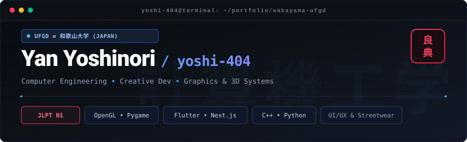

<!-- ============================================================ -->
<!-- HEADER BANNER: Suporte nativo a Tema Claro / Escuro via SVG   -->
<!-- ============================================================ -->

  <picture>
    <source media="(prefers-color-scheme: dark)" srcset="./assets/header-dark.svg">
    <source media="(prefers-color-scheme: light)" srcset="./assets/header-light.svg">
    
  </picture>

# Yan Yoshinori (良典)
### Computer Engineering • Creative Developer • 3D Graphics & Systems

`UFGD (Brasil) ⇄ Wakayama University (和歌山大学)` &nbsp;•&nbsp; `JLPT N1 Certified`

  Atuação na intersecção entre <b>computação gráfica</b>, <b>engenharia de software</b> e <b>interfaces interativas</b>. 
  Do desenvolvimento de baixo nível (C++, OpenGL, shaders) a produtos web e mobile (Next.js, Flutter).

  <a href="#sobre-mim">Sobre</a> &nbsp;•&nbsp;
  <a href="#tecnologias">Stack</a> &nbsp;•&nbsp;
  <a href="#projetos-selecionados">Projetos</a> &nbsp;•&nbsp;
  <a href="#atividade--métricas">Métricas</a> &nbsp;•&nbsp;
  <a href="#idiomas--formação">Idiomas</a>

---

### Sobre mim

- Graduando em **Engenharia da Computação** pela **UFGD** (Brasil).
- Intercâmbio acadêmico em Engenharia de Sistemas na **Universidade de Wakayama (和歌山大学)**, Japão.
- Certificação **JLPT N1 (日本語能力試験 N1)** — proficiência plena no idioma japonês.
- Desenvolvimento do **UniFluxo** (Flutter) como projeto de conclusão de curso (TCC), voltado à centralização de rotinas universitárias.
- Desenvolvimento de **The Shining Maze**, labirinto 3D com renderização em OpenGL, cálculos de projeção e pipeline de CI/CD via GitHub Actions.
- Foco prático em computação visual, sistemas de design de interfaces e cultura streetwear (com interesse em marcas clássicas como Onitsuka Tiger).

---

### Contato

  &nbsp;&nbsp;
  &nbsp;&nbsp;
  &nbsp;&nbsp;
  &nbsp;&nbsp;
  

---

### Tecnologias

  

  
  
  
  

---

### Projetos Selecionados

<table width="100%">
  <tr>
    <td width="50%" valign="top">
      <h4><a href="#">UniFluxo</a></h4>
      
<i>Assistência e centralização da rotina acadêmica universitária</i>

      
Projeto de Conclusão de Curso (TCC) concebido para o ecossistema de estudantes da UFGD. Centraliza horários, fluxos acadêmicos e tarefas com uma interface limpa, ágil e acessível construída em Flutter.

      

        
        
        
      

      Status: <b>Projeto de TCC (UFGD) • Em desenvolvimento</b>
    </td>
    <td width="50%" valign="top">
      <h4><a href="#">The Shining Maze</a></h4>
      
<i>Labirinto 3D com renderização em OpenGL e pipeline CI/CD</i>

      
Jogo de terror em primeira pessoa desenvolvido em Python, implementando matemática de projeções 3D, iluminação dinâmica, controle de câmera e pipeline automatizado com GitHub Actions.

      

        
        
        
      

      Status: <b>Concluído / Repositório Público</b>
    </td>
  </tr>
  <tr>
    <td width="50%" valign="top">
      <h4><a href="#">Digital Meishi (デジタル名刺)</a></h4>
      
<i>Cartão de visitas digital multilíngue de alta performance</i>

      
Aplicação web interativa com suporte multilíngue (Português, Inglês e Japonês), layout responsivo de inspiração editorial e deploy otimizado na edge da Vercel.

      

        
        
        
      

      Status: <b>Live na Vercel</b>
    </td>
    <td width="50%" valign="top">
      <h4><a href="#">KutsuLab</a></h4>
      
<i>Conceito editorial e curadoria de sneakers (Streetwear)</i>

      
Projeto de interface e design system desenhado no Figma, estruturado para reviews e histórias por trás de sneakers clássicos como Onitsuka Tiger.

      

        
        
        
      

      Status: <b>Conceito de UI / Design System</b>
    </td>
  </tr>
</table>

---

### Atividade &amp; Métricas

  
  &nbsp;
  

  

---

### Idiomas &amp; Formação

<table width="100%">
  <tr>
    <td width="33%" valign="top">
      <b>Português</b> 
      <b>Nativo</b>
      
Comunicação primária e graduação em Engenharia da Computação na <b>UFGD</b>.

    </td>
    <td width="33%" valign="top">
      <b>日本語 (Japonês)</b> 
      <b>JLPT N1 Certified (日本語能力試験 N1)</b>
      
Intercâmbio acadêmico em Engenharia de Sistemas na <b>Universidade de Wakayama</b>. Capacidade de atuação profissional plena.

    </td>
    <td width="33%" valign="top">
      <b>English</b> 
      <b>Full Professional Proficiency</b>
      
Consumo e escrita de documentação técnica, open source e atuação com times internacionais.

    </td>
  </tr>
</table>

  
<b>Intercâmbio acadêmico na Universidade de Wakayama (和歌山大学)</b>

   
  <blockquote>
    Durante o intercâmbio na <b>Universidade de Wakayama</b>, integrei disciplinas da divisão de Engenharia de Sistemas. A vivência consolidou a conquista do <b>JLPT N1</b> (nível máximo de certificação da língua japonesa) e aprofundou a busca contínua por integrar engenharia técnica de sistemas a um padrão visual refinado.
  </blockquote>

---

  
    Aberto para discussões sobre computação gráfica 3D, desenvolvimento mobile/web, intercâmbio no Japão e design de interfaces.
  

  

