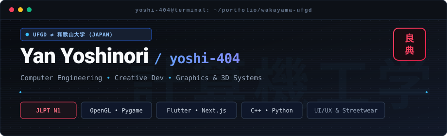

<!-- ============================================================ -->
<!-- HEADER BANNER: Native Light / Dark theme support via SVG     -->
<!-- ============================================================ -->

  <picture>
    <source media="(prefers-color-scheme: dark)" srcset="./assets/header-dark.svg">
    <source media="(prefers-color-scheme: light)" srcset="./assets/header-light.svg">
    
  </picture>

  <b>English</b> &nbsp;|&nbsp;
  <a href="./README.pt-BR.md">Português</a> &nbsp;|&nbsp;
  <a href="./README.ja.md">日本語</a>

# Yan Yoshinori (良典)
### Computer Engineering • Creative Developer • 3D Graphics & Systems

`UFGD (Brazil) ⇄ Wakayama University (和歌山大学)` &nbsp;•&nbsp; `JLPT N1 Certified` &nbsp;•&nbsp; `TOEIC 840 Points`

  Working at the intersection of <b>computer graphics</b>, <b>software engineering</b> and <b>interactive interfaces</b>. 
  From low-level development (C++, OpenGL, shaders) to web and mobile products (Next.js, Flutter).

  <a href="#about-me">About</a> &nbsp;•&nbsp;
  <a href="#tech-stack">Stack</a> &nbsp;•&nbsp;
  <a href="#selected-projects">Projects</a> &nbsp;•&nbsp;
  <a href="#activity--metrics">Metrics</a> &nbsp;•&nbsp;
  <a href="#languages--education">Languages</a>

---

### About me

- **Computer Engineering** undergraduate at **UFGD** (Brazil).
- Academic exchange in Systems Engineering at **Wakayama University (和歌山大学)**, Japan.
- International proficiency certifications: **JLPT N1** (Japanese, obtained in 2020) and **TOEIC 840 points** (English, advanced level).
- Building **UniFluxo** (Flutter) as my undergraduate thesis project, focused on centralizing university routines.
- Developed **The Shining Maze**, a 3D maze rendered with OpenGL, featuring projection math and a CI/CD pipeline via GitHub Actions.
- Hands-on focus on visual computing, interface design systems and streetwear culture (with an interest in classic brands like Onitsuka Tiger).

---

### Contact

  &nbsp;&nbsp;
  &nbsp;&nbsp;
  &nbsp;&nbsp;
  &nbsp;&nbsp;
  

---

### Tech Stack

  

  
  
  
  

---

### Selected Projects

<table width="100%">
  <tr>
    <td width="50%" valign="top">
      <h4><a href="#">UniFluxo</a></h4>
      
<i>Assistant for organizing and centralizing university academic routines</i>

      
Undergraduate thesis project designed for the UFGD student ecosystem. Centralizes schedules, academic workflows and tasks in a clean, fast and accessible interface built with Flutter.

      

        
        
        
      

      Status: <b>Undergraduate Thesis (UFGD) • In development</b>
    </td>
    <td width="50%" valign="top">
      <h4><a href="https://github.com/Yoshi-404/the_shining_maze">The Shining Maze</a></h4>
      
<i>3D maze with OpenGL rendering and a CI/CD pipeline</i>

      
First-person horror game built in Python, implementing 3D projection math, dynamic lighting, camera control and an automated pipeline with GitHub Actions.

      

        
        
        
      

      <a href="https://github.com/Yoshi-404/the_shining_maze"><b>GitHub Repository</b></a> &nbsp;•&nbsp; <a href="https://yoshi-hiro.itch.io/the-shining-maze"><b>Play on Itch.io ↗</b></a>
    </td>
  </tr>
  <tr>
    <td width="50%" valign="top">
      <h4><a href="https://github.com/Yoshi-404/digital-meishi">Digital Meishi (デジタル名刺)</a></h4>
      
<i>High-performance multilingual digital business card</i>

      
Interactive web application with multilingual support (Portuguese, English and Japanese), an editorial-inspired responsive layout and an optimized deploy on Vercel's edge.

      

        
        
        
      

      <a href="https://github.com/Yoshi-404/digital-meishi"><b>GitHub Repository</b></a> &nbsp;•&nbsp; <a href="https://digital-meishi-yosh.vercel.app"><b>Live on Vercel ↗</b></a>
    </td>
    <td width="50%" valign="top">
      <h4><a href="https://kutsu-lab.vercel.app">KutsuLab</a></h4>
      
<i>Editorial concept and sneaker curation (Streetwear)</i>

      
Interface and design system project designed in Figma, structured around reviews and the stories behind classic sneakers like Onitsuka Tiger.

      

        
        
        
      

      <a href="https://kutsu-lab.vercel.app"><b>Live on Vercel ↗</b></a>
    </td>
  </tr>
</table>

---

### Activity &amp; Metrics

  <picture>
    <source media="(prefers-color-scheme: dark)" srcset="./assets/ascii-telemetry-dark.svg">
    <source media="(prefers-color-scheme: light)" srcset="./assets/ascii-telemetry-light.svg">
    
  </picture>

---

### Languages &amp; Education

<table width="100%">
  <tr>
    <td width="33%" valign="top">
      <b>Português (Portuguese)</b> 
      <b>Native</b>
      
Primary language and Computer Engineering degree at <b>UFGD</b>.

    </td>
    <td width="33%" valign="top">
      <b>日本語 (Japanese)</b> 
      <b>JLPT N1 Certified (2020)</b>
      
Full proficiency achieved in 2020. Academic exchange in Systems Engineering at <b>Wakayama University</b>.

    </td>
    <td width="33%" valign="top">
      <b>English</b> 
      <b>TOEIC 840 Points (Advanced / C1)</b>
      
Scored 840 on the TOEIC. Professional communication, reading and writing technical documentation, and collaboration with global teams.

    </td>
  </tr>
</table>

  
<b>Academic exchange at Wakayama University (和歌山大学)</b>

   
  <blockquote>
    During my exchange at <b>Wakayama University</b>, I took courses in the Systems Engineering division, deepening my exposure to Japanese engineering methods, software architecture and interactive systems. My strong command of the language (certified by passing the <b>JLPT N1 in 2020</b>) allowed me to engage with the Japanese academic and technical environment with full autonomy.
  </blockquote>

---

  
    Open to conversations about 3D computer graphics, mobile/web development, studying in Japan and interface design.
  

  

